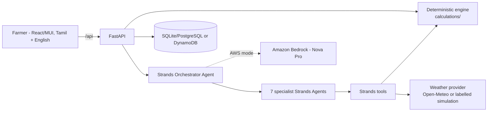
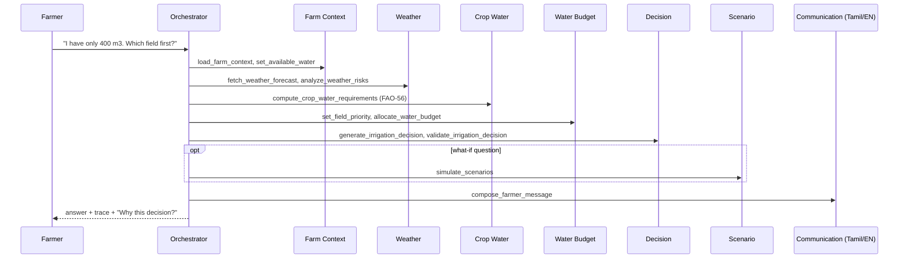
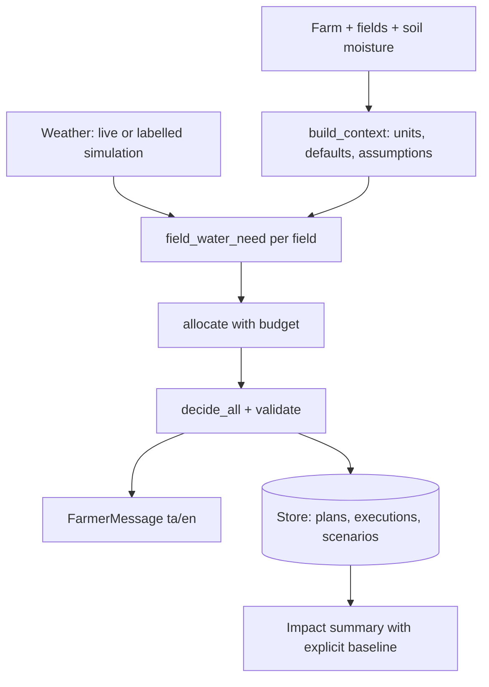

# NeerAI Architecture

## System architecture

## Multi-agent workflow

### Why each agent exists
| Agent | Reason | Owns (deterministic tools) |
|---|---|---|
| Farm Context | Normalises units, finds missing inputs, asks instead of guessing | `load_farm_context`, `set_available_water` |
| Weather Intelligence | Rain probability, heat risk, forecast confidence, honesty about simulated data | `fetch_weather_forecast`, `analyze_weather_risks` |
| Crop Water Intelligence | ETc = Kc x ET0, root-zone depletion, effective rain, efficiency | `compute_crop_water_requirements` |
| Water Budget & Allocation | Priority allocation under scarcity; farmer overrides | `set_field_priority`, `allocate_water_budget` |
| Irrigation Decision | Combines evidence into an action, with validation | `generate_irrigation_decision`, `validate_irrigation_decision` |
| Scenario Simulation | Before/after comparison of hypothetical conditions | `simulate_scenarios` |
| Tamil Farmer Communication | Simple Tamil/English message from verified numbers | `compose_farmer_message` |

### Orchestration design (real Strands, not renamed prompts)
* The orchestrator is a `strands.Agent` whose **tools are the specialists** (agents-as-tools). Each specialist is its own `strands.Agent` with a system prompt, tools and a `HookProvider` (`TraceHook`).
* **Execution trace** = real `BeforeToolCallEvent`/`AfterToolCallEvent` hooks (tool, status, duration, redacted summary). `BeforeToolCallEvent.cancel_tool` enforces the per-request tool-call limit.
* **Models:** AWS mode uses `BedrockModel` (Nova Pro). Demo mode uses `ScriptedModel`, a genuine `strands.models.Model` subclass that emits tool-use events from a deterministic policy, so the Strands event loop, tool registry and delegation all run without credentials.
* **LLM never computes numbers.** All quantities come from `app/calculations`. In Bedrock mode the LLM narrative is accepted only if every quantity (number + unit) traces to tool output (`numbers_consistent`); otherwise the template answer is used.
* **Reliability:** specialist retries (`agent_max_retries`), request timeout (`agent_timeout_s`, 504), tool-call cap, and `reconcile()` which deterministically computes any step the agent loop failed to produce (traced as `fallback`). Missing essential inputs produce `INSUFFICIENT_DATA` and follow-up questions.

## Calculation model (docs for reviewers)
* ETc = Kc x ET0 (FAO-56); TAW = 1000 (FC-WP) Zr; RAW = p x TAW; irrigation triggers at RAW (80% of RAW in critical stages). Paddy is ponded: loss = ETc + percolation, buffer 50 mm.
* Effective rain/day = 0.8 x (P - 2 mm), weighted by forecast probability, ignored below 30% chance. End-of-horizon depletion with and without rain determines need; rain "covers" the need if depletion stays under the trigger.
* Gross depth = net / efficiency; litres = area_ha x mm x 10,000.
* Allocation: score = crop weight x stage factor (critical x2) x (1 + min(stress,2)/2) x farmer multiplier. Critical/pinned fields are funded first in rank order; the rest share remaining water by score (water-filling, capped at demand). Invariant `sum(allocated) <= available` is property-tested.
* Parameters in `backend/app/calculations/data/*.json` are **sample FAO-56-based values**; validate locally.

## Data flow

## AWS deployment
Serverless, Docker-free; full detail, job lifecycle and diagram in [DEPLOYMENT.md](DEPLOYMENT.md). Summary: Amplify Hosting (React) -> API Gateway HTTP API with Cognito JWT authorizer -> Lambda (FastAPI/Mangum) for short routes; `POST /api/jobs` writes a DynamoDB job record and an SQS message, a worker Lambda runs the Strands agents against Bedrock, and the browser polls `GET /api/jobs/{id}`. Data is partitioned per user (`USER#`), so tenant isolation is part of the storage key. Security: [SECURITY.md](SECURITY.md). Operations: [OPERATIONS.md](OPERATIONS.md).
