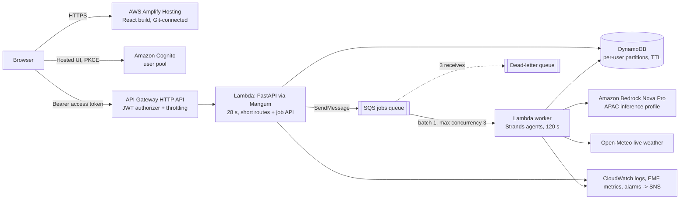

# Deployment (AWS, serverless, Docker-free)

> **Status: nothing is deployed.** Code, tests, CDK synthesis and CI definitions are done; no AWS resources exist for NeerAI.
> `cdk deploy` creates billable resources and requires explicit approval. See [cost-estimate](COST_ESTIMATE.md).

Target: account of the `AI-agent` profile, region `ap-south-1`. Stack names are NeerAI-specific (`NeerAI-Dev`, `NeerAI-Prod`);
the template contains no reference to, and cannot modify, other stacks (FloodLens, billsense, ShopFlow, ...).

## Architecture


| Concern | Choice |
|---|---|
| Synchronous (fast, deterministic) | plan, allocate, simulate, farms/fields CRUD, impact, job status: API Lambda |
| Asynchronous (agent workflows) | `POST /api/jobs` -> DynamoDB job record + SQS -> worker Lambda; client polls `GET /api/jobs/{id}` |
| Legacy sync agent routes | `/api/agent/chat`, `/api/irrigation/assess` return **410** when `NEERAI_ENV=aws` (kept for local use) |
| Frontend | Amplify Hosting (Git-based builds). **Not created by CDK**: connecting GitHub safely needs the Amplify GitHub App in the console; the CDK alternative would store a long-lived GitHub token |
| Secrets | **None required.** Cognito ids and API URL are public identifiers; Secrets Manager is deliberately not used |

No ECS, Fargate, ECR, ALB, NAT Gateway, CloudFront, WAF or Docker are used.

## Job lifecycle
`queued -> running -> succeeded | failed`. A retried attempt returns a job to `queued` (`progress: retrying`).
* **Idempotency**: `Idempotency-Key` header -> deterministic job id; creation is a conditional write, so a replayed POST returns the same job (HTTP 200).
* **No duplicate processing**: the worker claims a job with an optimistic-lock (`version`) conditional write; a live lease (job timeout + 30 s) blocks other workers; terminal jobs and unknown/forged messages are acknowledged and ignored. The only side effect (the execution record) has an id derived from the job id, so a replay overwrites rather than duplicates.
* **Retries**: transient failure -> job back to `queued`, message re-delivered after exponential backoff + jitter (15 s, 30 s, 60 s ... cap 5 min, via `ChangeMessageVisibility`). After `JOB_MAX_ATTEMPTS` (3) the job is `failed` with a safe message; SQS redrives poison messages to the **DLQ** after 3 receives.
* **Timeouts aligned**: agent per-call Bedrock read timeout 90 s; job deadline 100 s; worker Lambda 120 s; queue visibility 180 s (must be >= the function timeout); API Lambda 28 s (API Gateway's 30 s limit).
* **Concurrency limit**: event source mapping max concurrency (default 3, `-c workerConcurrency=N`) caps simultaneous agent runs/Bedrock load without reserved concurrency (new accounts often have too little unreserved quota for that). Per-user limits: 2 active jobs, 40 jobs/day.
* **TTL**: job records expire after 7 days (DynamoDB TTL; reads also ignore expired items because TTL deletion is lazy).

## Prerequisites (one-time)
1. AWS CLI profile `AI-agent`, region `ap-south-1`; **Bedrock model access** for Amazon Nova Pro (verified earlier: the `apac.amazon.nova-pro-v1:0` profile is ACTIVE and invoked successfully).
2. CDK bootstrap: `CDKToolkit` already exists in this account/region (qualifier `hnb659fds`, bootstrap version 32). No re-bootstrap needed.
3. GitHub repo: `Thirumalaiboobathi/NeerAI-Autonomous-Water-Intelligence-for-Smallholder-Farmers`, branch `main` (the app is in `neerai/`).
4. **Create the Amplify app first** (console > Amplify > Host web app > GitHub > select repo/branch `main`, tick "My app is a monorepo", app root `neerai/frontend`). Amplify picks up `amplify.yml` and `customHttp.yml` from the repo root. Add the SPA rewrite from `neerai/frontend/amplify-redirects.json` (Hosting > Rewrites and redirects). Note the default domain `https://main.<appId>.amplifyapp.com`; it is the CDK `frontendOrigin`. Let the first build finish or fail: it needs the env vars from step 7.

## Deploy (after approval)
```bash
# 1. package the Lambda ZIP. Real build runs on Linux (GitHub Actions does this); see "Packaging" below
python neerai/scripts/build_lambda.py

# 2. review
cd neerai/infrastructure/cdk && pip install -r requirements.txt
cdk diff NeerAI-Dev -c stage=dev -c frontendOrigin=https://main.<appId>.amplifyapp.com [-c alertEmail=you@example.com] [-c createBudget=true -c budgetEmail=you@example.com]

# 3. apply (creates billable resources)
cdk deploy NeerAI-Dev -c stage=dev -c frontendOrigin=https://main.<appId>.amplifyapp.com --outputs-file outputs.json

# 4. set Amplify environment variables from outputs.json, then redeploy the frontend
#    VITE_API_URL=<ApiUrl>  VITE_COGNITO_DOMAIN=<CognitoDomain>  VITE_COGNITO_CLIENT_ID=<UserPoolClientId>
# 5. smoke test
python neerai/scripts/smoke_test.py <ApiUrl>                      # public surface
python neerai/scripts/smoke_test.py <ApiUrl> --token <access token>   # full flow incl. a real Bedrock job
```
Context options: `stage` (dev|prod), `frontendOrigin` (required), `weatherProvider` (`openmeteo` default = strict live; `auto`; `mock`), `workerConcurrency`, `alertEmail`, `extraCallbackUrls` (dev only), `createBudget`+`budgetEmail` ($25/month with 80% actual and 100% forecast alerts).

### Packaging (Docker-free)
`scripts/build_lambda.py` installs pre-built Linux wheels (`manylinux2014_x86_64`/`manylinux_2_28_x86_64`, CPython 3.12, `--only-binary`) into `backend/build/lambda`, adds the app and `data/demo`, and fails above 240 MB unzipped. Estimated size ~70-150 MB unzipped (boto3/botocore are bundled and pinned, so behaviour does not depend on the runtime's version); no layer is needed. It refuses to run on Windows/macOS because some transitive dependencies carry OS markers that make cross-resolution fail (measured: `mcp` -> `pywin32`); the CI runner is Linux. `--stub` produces an app-only directory for `cdk synth` on any OS. **Measured (WSL Ubuntu, Python 3.12.3, x86_64, no Docker):** 120 top-level entries, 103.8 MB (99 MiB) unzipped, **40.2 MB zipped**, 19 native libraries all x86-64 ELF, no Windows binaries; the package imports and answers `GET /health/live` under Linux using only its own dependencies. Import time with Strands deferred to the worker: API module ~1.5 s warm-cache (5 s on a cold disk), worker init ~1.3 s; the first agent job additionally loads Strands (~2.5 s) inside the invocation. Lambda CPU is slower than the test machine, so real cold starts are unmeasured.

## CI/CD (GitHub Actions)
| Workflow | Trigger | What it does |
|---|---|---|
| `.github/workflows/ci.yml` | PR, push to main | backend ruff (E9,F) + pytest + pip-audit; frontend tsc + vitest + build + npm audit; real Lambda package build + size check; CDK synth + `check_template.py` policy checks |
| `.github/workflows/deploy.yml` | **manual only** (`workflow_dispatch`) | OIDC auth, account check, tests, package, `cdk diff`, optional `cdk deploy`, public smoke test |

No AWS keys exist in GitHub. One-time OIDC setup (an administrator, not the pipeline):
```bash
aws cloudformation deploy --stack-name NeerAI-GithubOidc --template-file .github/oidc/github-oidc-role.yml \
  --capabilities CAPABILITY_NAMED_IAM --region ap-south-1 \
  --parameter-overrides PinWorkflowClaims=true PinDevWorkflowClaims=false \n  GitHubOrgRepo=Thirumalaiboobathi/NeerAI-Autonomous-Water-Intelligence-for-Smallholder-Farmers \n  DevSubjectRepo=<owner>@<ownerId>/<repo>@<repoId>
```
(`DevSubjectRepo`: this repository issues *immutable* OIDC subjects, so the dev role's `sub` must be copied from a real token - run the diagnostic step that prints only `sub` and `aud`. AWS documents only `aud`/`sub`/`amr` as condition keys for GitHub, so the `ref`/`job_workflow_ref` pin was denied at sign-in for dev (`PinDevWorkflowClaims=false`); the prod role still carries the pin and has not been exercised - before the first prod deploy verify prod's subject the same way.) (add `CreateOidcProvider=false` if the GitHub OIDC provider already exists in the account). Two roles are created, one per GitHub Environment (`neerai-github-deploy-dev`, `neerai-github-deploy-prod`); each trusts only its own environment of this repository, and (when `PinWorkflowClaims=true`, default) only `deploy.yml` on `refs/heads/main`. They may only assume the CDK bootstrap roles and read their own NeerAI stack. Then in GitHub create Environments `dev` and `prod` (add required reviewers to `prod`; set **Deployment branches: main only** on both) with the non-secret variables `AWS_ACCOUNT_ID`, `FRONTEND_ORIGIN`, `ALERT_EMAIL`. The workflow derives the role (`neerai-github-deploy-dev` / `-prod`) from the stage, so no role ARN variable is needed.
Frontend deployment = push to the connected branch; Amplify builds and publishes it (preview deployments for pull requests can be enabled in Amplify > Previews; their origins must be added to `extraCallbackUrls`/CORS to sign in).

## Expected AWS resources (NeerAI-Dev, 53 in the template)
DynamoDB table (on-demand, PITR, TTL, retained) - 2 SQS queues (jobs + DLQ, SSE) - 2 Lambda functions + 3 log groups - HTTP API + JWT authorizer + stage (throttle 20 rps/burst 40; `POST /api/jobs` 3/6) - Cognito user pool, app client, hosted-UI domain - SNS alarm topic - 14 CloudWatch alarms + 1 dashboard - 2 IAM roles with inline policies - optional budget.
The CDK Lambda asset also lands in the existing CDK bootstrap bucket.

## Rollback
* Bad code: re-run the deploy workflow on the previous good commit (CloudFormation rolls a failed update back automatically).
* Bad data change: DynamoDB point-in-time recovery restores to a new table (it never overwrites in place).
* Stuck queue: purge/redrive the DLQ from the SQS console after fixing the cause (see [operations](OPERATIONS.md)).
* Frontend: Amplify > Deployments > redeploy a previous build.

## Teardown
`cdk destroy NeerAI-Dev -c stage=dev -c frontendOrigin=...` (run manually; never automated). The DynamoDB table and Cognito user pool use `RETAIN`, so user data survives stack deletion; delete them by hand when you really want the data gone. Delete the Amplify app in the console. `NeerAI-GithubOidc` is separate.

## Authentication risk notes
Access tokens are kept in `sessionStorage` (PKCE hosted-UI flow); the Amplify CSP in `customHttp.yml` limits script sources, but any XSS would expose them. Self-service sign-up is enabled for the demo (Cognito default email: ~50 emails/day limit); disable it (`self_sign_up_enabled=False`) and create users manually for a closed pilot.
